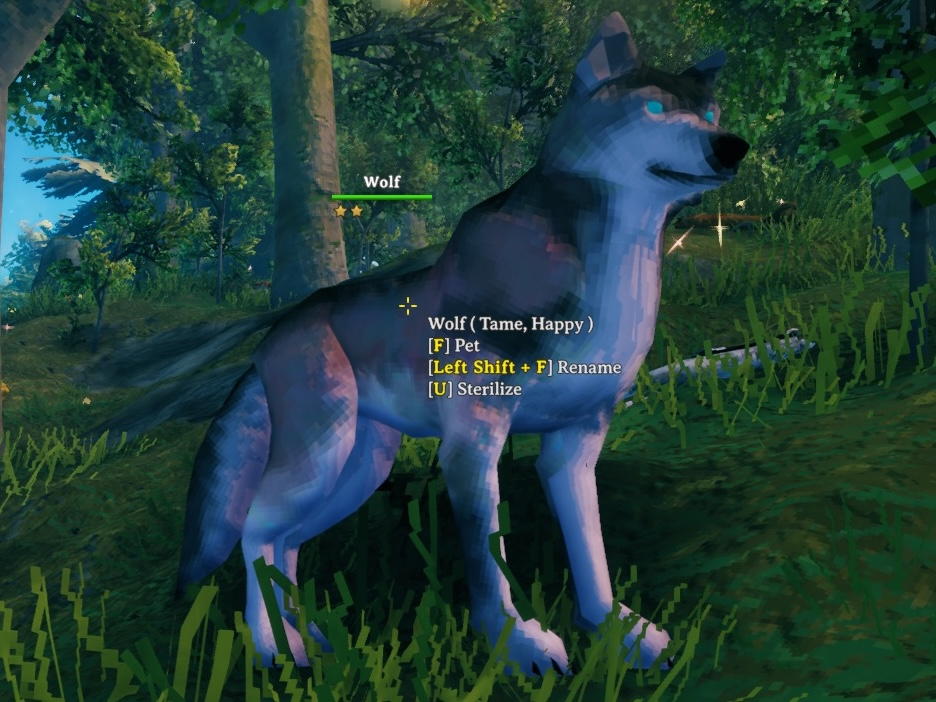
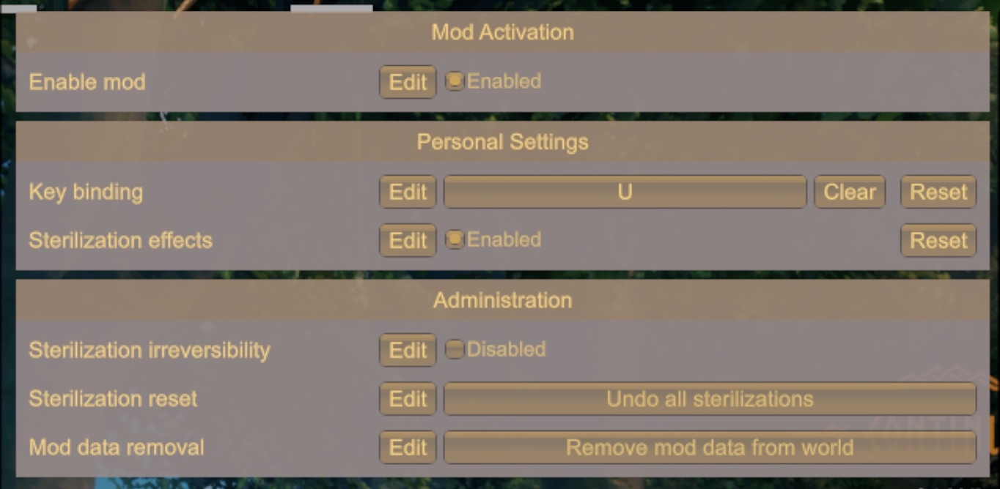
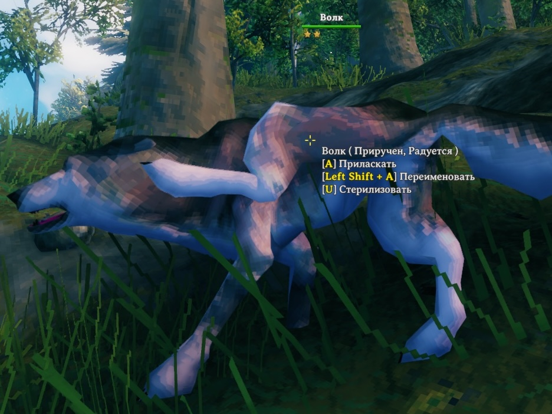
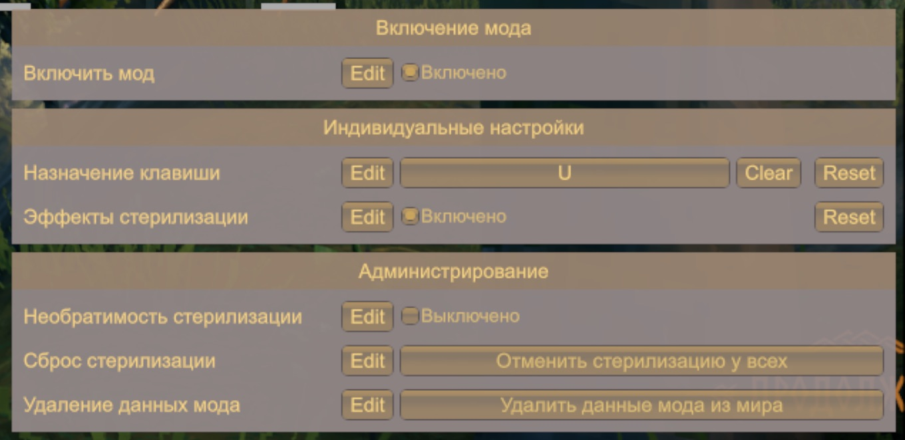

[Русское описание / Russian description](#off-with-their-nuts-1)
# Off With Their Nuts!

Regular boars messing up your two-star breeding plans?  
Have the wolves guarding your base eaten all the deer and filled the woods with their pups?  
Can't get out of your house because of a herd of lox?  
**Just cut their nuts off!**

 

The mod lets you prevent individual tamed animals from breeding. A sterilized animal can neither produce offspring nor impregnate another animal. Sterilization is reversible by default.

Seems to work in multiplayer. I built it with multiplayer in mind and tested it in two-player co-op.

## Features

- Aim at an animal and press `U` to sterilize it or undo sterilization. You can change the key or key combination inn confi file or through Valheim Configuration Manager.
- A status line appears when you aim at a sterilized animal.
- You can suspend all breeding restrictions in the mod settings. The mod remembers which animals were sterilized, and the restrictions take effect again when you re-enable it.
- Admins can make sterilization irreversible. While this setting is enabled, you cannot undo sterilization for an individual animal.
- The administration section has a button to undo sterilization for every animal in the world, including those in unloaded areas. The button is available in single-player and to all admins in multiplayer.
- You can safely uninstall the mod by deleting its files. The administration section has a button to remove mod data from the world if you want to leave no traces in your saves or need to debug something.
- The mod supports English, Russian, Portuguese, Spanish, German, Polish, Turkish, Ukrainian, French, Chinese, and Japanese. It uses English if your game is set to any other language.

 

## Installation

Just use thunderstore mod manager.

But if you want to do it by yourself - download and extract the archive and move the "OffWithTheirNuts" folder into your plugins folder:

- Windows: `C:\Program Files (x86)\Steam\steamapps\common\Valheim\BepInEx\plugins`
- macOS: `~/Library/Application Support/Steam/steamapps/common/Valheim/BepInEx/plugins`

In multiplayer, the server and every player need the same version of the mod.

The mod requires BepInEx and Jötunn. Valheim Configuration Manager is optional.

## Notes

I tested the mod on Windows and on macOS with a custom Apple Silicon (ARM64) build of BepInEx.

Post bug reports and suggestions at my [Github Issues](https://github.com/rehallowed/Off-With-Their-Nuts/issues).

  

# Off With Their Nuts!

Обычные свиньи мешают размножаться двухзвёздочным?  
Охраняющие базу волки сожрали всех оленей и заполонили леса своими отпрысками?  
Толпа быкоящеров не даёт выйти из дома?   
**Почему бы вам не отрезать им яйца!**

 

Мод позволяет выборочно запретить размножение приручённому животному. Стерилизованное животное не сможет дать потомство или оплодотворить другую особь. По умолчанию стерилизация обратима.

Вроде как работает в мультиплеере. По крайней мере, писал я его с расчётом на мультиплеер, а потом проверил в коопе на двоих.

## Функции

- Стерилизация или её отмена делается нажатием клавиши `U` при наведении на животное. Клавишу или сочетание можно сменить в конфиге (доступен через Valheim Configuration Manager).
- При наведении на животное, если оно стерилизовано, отображается соответствующий статус.
- В настройках мода можно глобально отключить действие стерилизации. При этом статусы стерилизации животных сохраняются и продолжат действовать при включении.
- Админы могут включить необратимость стерилизации. Пока эта настройка включена, отменить стерилизацию у отдельного животного нельзя.
- В админской секции настроек есть кнопка сброса статуса стерилизации для всех животных в мире, втч в выгруженных зонах. Кнопка доступна в одиночной игре, а также всем админам в многопользовательской игре.
- Мод можно безопасно удалить простым удалением его файлов. На случай, если захочется не оставлять следов в сохранениях, а также для дебага, в админской секции настроек есть кнопка удаления данных мода.
- Поддержаны английский, русский, португальский, испанский, немецкий, польский, турецкий, украинский, французский, китайский и японский языки. Если в игре выбран другой язык, мод будет отображаться на английском.

 

## Установка

Просто используй thunderstore mod manager.

Но если хочется повозиться руками - скачай и распакуй архив, после чего перетащи папку "OffWithTheirNuts" в папку плагинов:
- На Windows: `C:\Program Files (x86)\Steam\steamapps\common\Valheim\BepInEx\plugins`.
- На macOS: `~/Library/Application Support/Steam/steamapps/common/Valheim/BepInEx/plugins`.

Для многопользовательской игры надо ставить одну версию мода и на сервер, и каждому игроку.

Для работы мода требуются BepInEx, Jötunn и опционально Valheim Configuration Manager.

## Прочее

Мод проверял на macOS с кастомной сборкой BepInEx под Apple Silicon (ARM64), а также на Windows.

Багрепорты и предложения кидайте в [Github Issues](https://github.com/rehallowed/Off-With-Their-Nuts/issues).